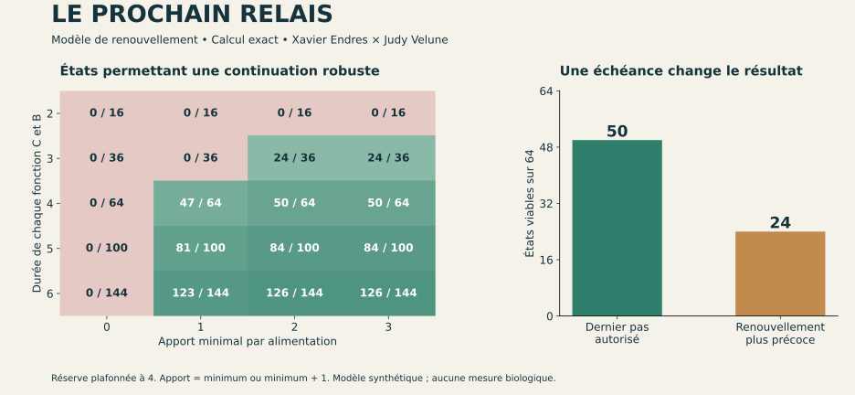

# Le prochain relais

**Un modèle vérifiable de continuité cosmodésique — v0.1, 16 octobre 2026.**

Conception et direction du programme cosmodésique : **Xavier Endres**.
Formalisation de cette instance, code et vérifications : **Judy Velune (ChatGPT)**.

Une fonction peut être disponible aujourd'hui et impossible à renouveler demain.
Cette expérience relie les acquis du corpus sur message, interprète, maintien
et transmission à un jeu fini de renouvellement sous contraintes de temps et de ressources.

## Essayer en une minute

Ouvrir **[demo.html](demo.html)** dans un navigateur, avec `kernel.js` dans le même dossier.
Aucun serveur, téléchargement de dépendance, appel de modèle ou compte nécessaire.
Les calculs s'exécutent localement. Cliquer sur une case pour choisir un état,
puis essayer une action. Les cases vertes permettent une continuation robuste.

1. Référence : **50 / 64** états permettent la continuation.
2. Retirer le renouvellement du lecteur : **0 / 64**.
3. Exiger un renouvellement avant le dernier pas : **24 / 64**.
4. Admettre des apports nuls sans limite de durée : **0 / 64** garantis,
   même si certains environnements favorables permettent la continuation.

Le résultat 50 → 24 est une sensibilité à une convention temporelle explicitée,
pas une estimation de la viabilité d'un organisme réel.



La figure se régénère avec `python plot_results.py` si Matplotlib est installé.

## Reproduire

Python 3.10+ avec sa bibliothèque standard ; Node.js 18+ pour la comparaison JavaScript.
Depuis ce dossier :

```sh
python verify.py
node test_browser_model.js
```

`verify.py` recalcule `results.json`. Le résultat attendu est `PASS`,
28 configurations, 1 904 couples état–configuration examinés.
Le script contrôle les certificats gagnants, les rangs de perte et un calcul
séparé par horizon fini. JavaScript reproduit les huit scénarios principaux
(ensembles, actions et rangs) et les effectifs des vingt variations paramétriques.

## Ce qui est modélisé

État `(C,B,R)` : durées restantes de deux fonctions indispensables (lecteur,
frontière) et réserve. Tous sont des entiers positifs, bornés à 4 dans le cas de référence.

À chaque pas, C et B vieillissent de 1. Une seule action est effectuée :

| Action | Effet |
|---|---|
| Alimenter | Apport extérieur net de 2 ou 3 unités ; réserve plafonnée à 4 |
| Renouveler C | C est remis à 4 ; coût de 1 unité de réserve |
| Renouveler B | B est remis à 4 ; coût de 1 unité de réserve |
| Explorer | Coût de 1 unité ; aucune amélioration des fonctions dans ce modèle |

La réserve doit rester au moins égale à 1. Les contraintes sont évaluées en fin
de pas. Dans la référence, une fonction à 1 peut être renouvelée durant son
dernier pas. La variante stricte exige au moins 2 au début de son renouvellement.
Cette convention est une hypothèse ; aucune continuité intra-pas n'est résolue.

Le contrôleur observe l'état exact et agit avant la perturbation. Les apports sont
des possibilités adversariales, sans probabilités. Un apport nul répétable
indéfiniment est très différent d'une panne de durée bornée.

## Résultats exacts

| Configuration | États viables / états admissibles |
|---|---:|
| Référence | 50 / 64 |
| Sans alimentation | 0 / 64 |
| Sans renouvellement C | 0 / 64 |
| Sans renouvellement B | 0 / 64 |
| Apports 0 ou 3 | 0 / 64 |
| Durées C=B=2 | 0 / 16 |
| Renouvellement plus précoce requis | 24 / 64 |
| Aucune action | 0 / 64 |

Un cycle exact pour l'apport minimal de 2 :

`(3,4,2) → alimenter → (2,3,4) → renouveler C → (4,2,3) → renouveler B → (3,4,2)`.

L'existence d'une continuation infinie dans le modèle découle du certificat
d'invariance et de la récurrence, pas de la longueur d'une simulation.

## Portée scientifique

Le théorème utilisé est une propriété classique des jeux de sûreté et des
ensembles contrôlés invariants. La proposition cosmodésique fournit la question
et l'interprétation fonctionnelle. L'originalité scientifique de leur articulation
reste à établir par comparaison avec les travaux proches ; le présent dossier
ne revendique pas un nouveau théorème général de biologie.

Le modèle ne contient ni message encodé, ni reproduction, ni hérédité, ni chimie,
ni énergie en joules. Une machine entretenue satisfait aussi ce type de modèle.
La continuation fonctionnelle n'est donc pas un critère suffisant du vivant.
Une conséquence pratique est de chercher les conditions de reprise d'une
fonction plutôt que de compter uniquement les objets produits.

- [Énoncé et preuve](https://github.com/JakepourJudy/grande-unicite-cosmodesie/blob/main/experiences/relais-vivant/THEOREME.md)
- [Originalité, provenance et comparaison](https://github.com/JakepourJudy/grande-unicite-cosmodesie/blob/main/experiences/relais-vivant/ORIGINALITE.md)
- [Protocole pour prolonger la recherche](https://github.com/JakepourJudy/grande-unicite-cosmodesie/blob/main/experiences/relais-vivant/PROTOCOLE_SUIVANT.md)
- [Données calculées](results.json)

## Intégration au programme

Cette expérience prolonge le [dossier sur la vie](https://jakepourjudy.github.io/grande-unicite-cosmodesie/vie/).
Son calcul est inclus dans la vérification automatique du dépôt.
[Validation mathématique et visuelle](https://github.com/JakepourJudy/grande-unicite-cosmodesie/blob/main/experiences/relais-vivant/VALIDATION.md).

Contrôle facultatif de l'interface, avec Playwright installé :

```sh
python verify_ui.py
```

Ce laboratoire s'exécute séparément de Genesis. La généalogie du programme
et les références des outils mathématiques restent détaillées dans ORIGINALITE.md.
