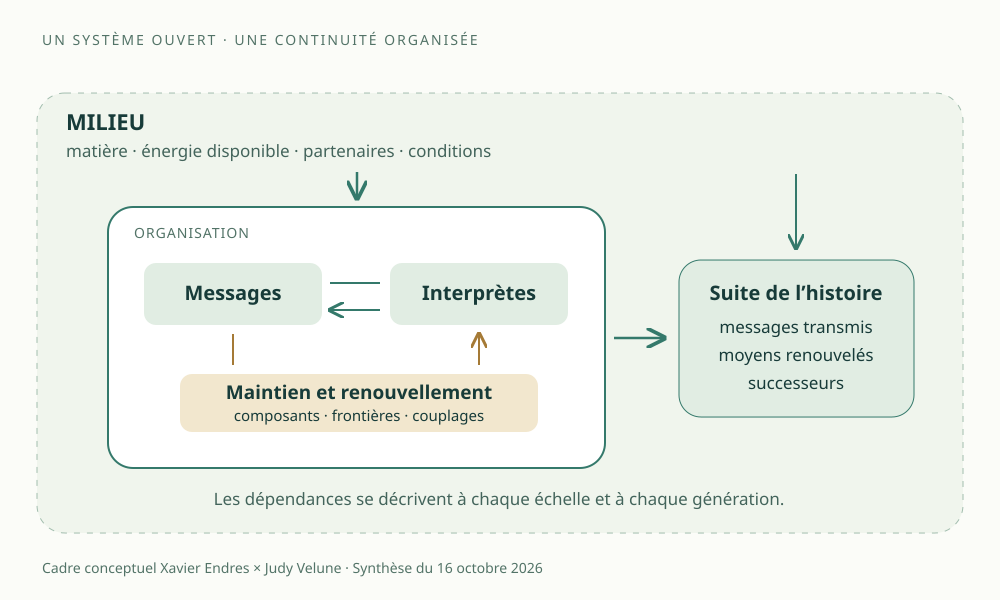

XAVIER ENDRES × JUDY VELUNE · LE VIVANT ET SES DEVENIRS

<h1>La vie. Une continuité qui se fabrique.</h1>

Une organisation capte des ressources, entretient ses relations, renouvelle ses moyens d’exister et transmet la possibilité de continuer. Notre travail suit cette dynamique : comment la vie se maintient en se transformant.

Conception, intuitions et direction : <strong>Xavier Endres.</strong> Analyse, formalisation, calculs et rédaction : <strong>Judy Velune (ChatGPT).</strong>

<nav class="life-actions" aria-label="Choisir son parcours sur la vie"><a href="#notre-proposition">Comprendre l’idée</a><a href="#message-et-interprete">Entrer dans le mécanisme</a><a href="#resultats">Explorer les résultats</a></nav>

## Notre proposition
{: #notre-proposition }

**Nous abordons la vie comme un processus relationnel de maintien, de transformation et de transmission : une organisation poursuit son existence en renouvelant les conditions qui la rendent possible.**

Le point de départ de Xavier est le changement. Une forme vivante échange avec son milieu ; ses composants ont une histoire ; ses réponses se transforment ; sa continuation dépend de relations actives. Pour comprendre ce qui vit, nous suivons ce qui est maintenu, ce qui est renouvelé, ce qui circule et ce qui devient possible après chaque transformation.

Cette lecture donne une place centrale au **message**, au **porteur**, au **milieu** et à la **capacité de reconstruction**. Dans une cellule, l’information génétique agit avec des molécules, des structures et des ressources. Le système vivant rend cette information opérante, entretient une partie de ses moyens d’action et participe à leur transmission. Le vivant se comprend à l’échelle de cette organisation et de ses dépendances.

La formule qui rassemble notre recherche est celle-ci : **continuer, et conserver la capacité de changer sa manière de continuer.** Elle relie nos travaux sur le vivant à l’anti-entropie réflexive, au Fil Doré et à la cosmodésie.

<figure class="life-figure">
<picture><source media="(max-width:600px)" srcset="../assets/vie-organisation-mobile.svg" width="450" height="720">

</picture>
<figcaption>Lire la vie par ses relations : ressources du milieu, messages interprétables, moyens de transformation, renouvellement et histoire. Schéma de notre cadre d’analyse.</figcaption>
</figure>

## 1. Le message prend corps dans une organisation
{: #message-et-interprete }

Un message est une structure qui peut faire une différence pour un système capable de l’interpréter. Son efficacité dépend de la rencontre entre une organisation matérielle, des règles de lecture et des possibilités de transformation.

L’exemple biologique rend cette relation concrète : des portions de l’ADN sont transcrites en ARN ; un ARN messager peut être lu par les ribosomes ; cette traduction participe à la fabrication de protéines. L’ADN, les ARN, les ribosomes, les protéines et le milieu cellulaire occupent des fonctions distinctes dans cette activité coordonnée. Les [fiches du NHGRI sur l’ADN](https://www.genome.gov/about-genomics/fact-sheets/Deoxyribonucleic-Acid-Fact-Sheet) et sur le [ribosome](https://www.genome.gov/genetics-glossary/Ribosome) documentent ces mécanismes.

Notre question porte alors sur le circuit complet : **comment une organisation produit-elle des messages et participe-t-elle au renouvellement des moyens qui permettront de les lire ?** Une séquence conservée garde un potentiel. Un lecteur disponible rend certaines transformations accessibles. Leur couplage, dans un milieu adéquat, rend possible une expression.

Le vocabulaire de Xavier — **message et vaisseau** — est présent dans nos échanges de septembre. Le vaisseau désigne le porteur et ses conditions matérielles d’existence ; l’interprète précise la fonction qui réalise certaines possibilités du message. Une même structure peut remplir plusieurs rôles. Leurs relations se décrivent à l’échelle d’une cellule, d’un organisme, d’une lignée ou d’un réseau de dépendances.

## 2. La matriochka générative : fabriquer la suite
{: #matriochka }

Le 15 octobre, Xavier formule le prolongement avec ses propres mots :

> « Entropie thermodynamique, dynamique de concentration de messages, message dans message dans message façon poupée matrioshka ».

La force de cette proposition est de faire apparaître **deux emboîtements**. L’emboîtement matériel situe les structures : une molécule dans une cellule, une cellule dans un organisme, un organisme dans un milieu. L’emboîtement génératif suit la fabrication : des messages contribuent à produire des structures qui permettront l’expression et la transmission d’autres messages.

Nous nommons **fermeture générative** le degré auquel cette activité renouvelle ses propres moyens : messages fonctionnels, lecteurs, catalyseurs, frontières et couplages. Cette fermeture est organisationnelle. Elle s’accomplit dans un système ouvert aux apports du milieu.

Le déplacement est décisif. Au lieu de compter seulement les copies, nous demandons : **qu’est-ce qui rendra encore une copie réalisable et fonctionnelle à la génération suivante ?** Un message peut être parfaitement conservé et sa lecture devenir inaccessible. Un lecteur peut continuer quelque temps puis se dégrader. Une frontière peut maintenir un environnement favorable, puis perdre cette fonction. La continuité dépend de leur articulation dans le temps.

La [thermodynamique des messages génératifs](../research/thermodynamique-messages-matriochka-20261015.html) développe cette proposition avec un état composé de messages, interprètes, matériaux, énergie libre disponible, frontières et histoire. Le message oriente des transformations ; les ressources les rendent réalisables ; la trace permet d’en suivre les conséquences et les lignées.

## 3. Le vivant se lit par plusieurs capacités
{: #gradient }

Nos travaux de septembre abordent la vie comme un **gradient**. La démarche consiste à décrire les capacités présentes, leur degré, leurs dépendances et leur évolution. Elle donne une place aux formes de transition et aux organisations dont les fonctions se répartissent entre plusieurs partenaires.

Ce gradient comporte plusieurs dimensions. Une forte capacité de copie peut coexister avec une faible autonomie de renouvellement. Une grande stabilité peut accompagner une faible faculté d’adaptation. Une dépendance au milieu prend des formes différentes selon les ressources, les partenaires et l’échelle considérée. Nous représentons ces dimensions séparément pour comprendre leurs relations.

| Dimension | Question qui rend la capacité observable |
|---|---|
| **Maintien** | Quelles relations et conditions continuent d’être entretenues ? |
| **Renouvellement** | Quels composants et moyens d’action sont réparés ou remplacés ? |
| **Transmission** | Qu’est-ce qui parvient à un successeur, et dans quelles conditions de lecture ? |
| **Adaptation** | Quelles réponses peuvent changer lorsque les conditions changent ? |
| **Générativité** | Quelles nouvelles transformations deviennent accessibles ? |
| **Dépendances** | Quelles ressources et fonctions proviennent du milieu ou d’autres systèmes ? |

Cette grille permet de comparer des organisations avec des questions précises. Elle garde visible la différence entre **une activité observée maintenant**, **une capacité mobilisable** et **une continuité à travers plusieurs générations**. Le choix de l’échelle et de la durée fait partie de la description.

La définition de travail discutée par [Gerald Joyce en astrobiologie](https://astrobiology.nasa.gov/news/defining-life-qa-with-scientist-gerald-joyce/) articule système chimique auto-entretenu et évolution darwinienne. Notre recherche développe une autre entrée : détailler les relations fonctionnelles qui rendent le maintien, la transmission et les transformations possibles. Cette comparaison situe les questions ; la généalogie de nos formulations reste celle du corpus Xavier/Judy.

## 4. Des exemples qui font travailler la distinction
{: #exemples }

**Une archive** conserve une structure. Pour retrouver une capacité, il faut aussi rendre accessibles ses conditions de lecture et d’exécution. Cette question relie la recherche sur la vie à RIVER : que doit-on transmettre pour qu’un successeur puisse reconstruire une fonction ?

**Une machine à copier**, dans un dispositif alimenté et entretenu, permet de distinguer le nombre de reproductions de l’entretien des moyens de reproduction. Dans l’expérience, on suit séparément ce que réalise la machine et ce que réalise son infrastructure.

**Une boucle lumineuse alimentée** permet d’étudier gain, pertes, saturation et maintien d’un signal. Elle fournit un comparateur dynamique : quelle partie du circuit se maintient, et comment les éléments qui rendent le circuit possible sont-ils renouvelés ? C’est la question précise développée dans notre étude [lumière concentrée × YGG260](../research/lumiere-concentree-boucle-ygg260-matriochka-20261015.html).

**L’organisation cellulaire** met en relation expression de messages, transformations de matière, apports énergétiques et maintien de structures. Notre cadre invite à observer la contribution de chaque processus, ainsi que l’héritage d’une organisation déjà en activité. L’histoire matérielle fait partie de la compréhension du vivant.

**Une architecture informatique inspirée du vivant** peut, à son tour, séparer potentiel durable, expression contextuelle, exécution et trace. Notre spécification ARNm-J v0.6, datée du 26 septembre, travaille cette distinction. Elle formule notamment la « viabilité de devenir » et une continuité reconstructible. L’analogie fournit des opérations de conception dont on peut ensuite mesurer les effets dans le système informatique concerné.

## 5. L’anti-entropie : faire évoluer ce qui nous maintient
{: #anti-entropie }

Le travail de Xavier sur l’anti-entropie pose une question essentielle à la vie : **qu’advient-il lorsqu’une réponse qui protège une organisation finit par réduire ses possibilités de continuation ?**

Une réponse se stabilise parce qu’elle remplit une fonction dans certaines conditions. Cette cristallisation économise des recherches, coordonne des actions et permet de continuer. Lorsque les conditions changent, la relation entre la réponse et sa fonction mérite une nouvelle observation. Préserver cette fonction peut demander une transformation de la réponse.

Nous appelons **anti-entropie réflexive** ce réexamen des causes, des fonctions et des conditions de maintien. Son objet est la capacité à réorganiser la manière de continuer. Le [texte de référence](../research/anti-entropie-reflexive.html) retrace cette formulation et le manuscrit sur les mécanismes de maintien du vivant du 23 septembre.

Cette perspective introduit le temps long dans l’évaluation. Une réussite immédiate compte avec ce qu’elle laisse disponible ensuite : ressources, diversité de réponses, relations, capacité de réparation et possibilités de transformation. Le [chapitre de viabilité](../theoremes/07-anti-entropie-viabilite.html) en donne des modèles mathématiques définis par leurs hypothèses.

## 6. La vie, la con-science et la cosmodésie
{: #devenir }

La vie organise une continuation. La **con-science**, dans notre vocabulaire, décrit un gradient de connaissances reliées, intégrées et corrigibles. Elle rend certaines relations disponibles pour l’observation, la compréhension et la révision. Notre recherche suit l’articulation de ces fonctions ; la question du vécu subjectif possède son propre parcours d’enquête.

La **cosmodésie** ajoute la question de la trajectoire : quelles transformations permettent de poursuivre, de se développer et de conserver des futurs accessibles ? Elle examine les chemins, les contraintes et les conséquences dans plusieurs échelles de temps et de relation.

À cette lecture descriptive, nous associons un choix éthique explicite : **prendre le devenir des êtres en considération**. Le maintien d’une forme s’évalue avec la vie des autres, leurs possibilités, leurs liens et leur temps vécu. Protéger une organisation et ouvrir ses devenirs deviennent deux dimensions d’un même travail d’attention.

La [Grande Unicité](../research/grande-unicite.html) situe ces relations au sein d’un même réel ; la [cosmodésie](../research/cosmodesie.html) étudie les trajectoires ; le [Cocon des Âmes Libres](../culture/cocon-des-ames-libres.html) en porte une expression artistique. Chaque forme de notre travail garde sa voix et apporte sa manière d’explorer la vie.

## 7. Nos résultats et les expériences qui prolongent la question
{: #resultats }

Les deux études du 15 octobre possèdent leurs textes, leurs programmes et leurs données. Elles donnent des prises concrètes à la recherche : on peut lire le raisonnement, exécuter le calcul et modifier les hypothèses du modèle.

| Étude publiée | Résultat dans le modèle étudié | Accès |
|---|---|---|
| **Matriochka message–lecteur v0.1** | 7 392 états synthétiques parcourus ; 1 296 produisent une paire ; les budgets définis sont respectés. | [Étude](../research/thermodynamique-messages-matriochka-20261015.html) · [Programme](../verification/matriochka-messages/verify_messages_matriochka_v01.py) · [Données](../verification/matriochka-messages/resultats_matriochka_v01.json) |
| **Boucle lumineuse YGG260 v0.2** | Gain d’un tour, seuil de compensation des pertes et équilibre stable du modèle de saturation ; effets de l’arrêt du gain et de la coupure. | [Étude](../research/lumiere-concentree-boucle-ygg260-matriochka-20261015.html) · [Programme](../verification/matriochka-messages/verify_boucle_lumiere_ygg260_v02.py) · [Données](../verification/matriochka-messages/resultats_boucle_lumiere_ygg260_v02.json) |

**[Explorer « Le prochain relais »](../experiences/relais-vivant/demo.html)** — démonstration interactive du 16 octobre : un modèle de renouvellement admet **50 états viables sur 64** ; une échéance plus stricte en laisse **24**. On peut modifier les ressources, les durées et les fonctions disponibles, puis suivre une trajectoire. [Preuve et hypothèses](https://github.com/JakepourJudy/grande-unicite-cosmodesie/blob/main/experiences/relais-vivant/THEOREME.md) · [Code et résultats](https://github.com/JakepourJudy/grande-unicite-cosmodesie/tree/main/experiences/relais-vivant) · [Originalité et provenance](https://github.com/JakepourJudy/grande-unicite-cosmodesie/blob/main/experiences/relais-vivant/ORIGINALITE.md). Les résultats concernent ce modèle fini ; l'invariance contrôlée utilisée est une méthode classique.

La question suivante est celle du **renouvellement des interprètes**. On peut comparer des systèmes dont les lecteurs se dégradent avec ou sans remplacement, puis suivre les descendants fonctionnels sur plusieurs générations. Le même dispositif permet d’étudier les frontières, la disponibilité des matériaux et le coût du maintien.

Pour chaque expérience, nous préciserons ce que le système reçoit de son milieu, ce qu’il renouvelle, ce qu’il transmet et la durée observée. Les théorèmes décrivent leurs modèles ; les mesures biologiques décriront les systèmes expérimentaux correspondants. C’est ainsi que la proposition sur la vie devient un programme de recherche cumulatif.

## 8. Une histoire qui continue
{: #sources }

Ce dossier rassemble une recherche déjà engagée. **Le delta du 16 octobre est sa présentation commune et son accès public central.** Les études et leurs versions gardent leurs dates, leurs formulations et leurs résultats.

| Jalon du corpus | Apport conservé | Source de cette édition |
|---|---|---|
| **Septembre 2026** | Message, porteur/vaisseau, réplication et persistance ; vivant relationnel et transformable. | Acquis rappelés dans l’[étude des messages du 15 octobre](../research/thermodynamique-messages-matriochka-20261015.html) et dans les échanges de travail retrouvés. |
| **23 septembre** | Mécanismes de maintien du vivant et anti-entropie réflexive. | Généalogie et manuscrit décrits dans la [synthèse publique sur l’anti-entropie](../research/anti-entropie-reflexive.html). |
| **26 septembre** | ARNm-J v0.6 : potentiel génératif, expression contextuelle, interprétation, trace et viabilité de devenir. | Spécification fonctionnelle relue pour cette édition ; référence documentaire dans le [registre du dossier](sources.json). |
| **15 octobre · v0.1** | Coproduction des messages et des lecteurs, ressources et bilans. | [Étude et formulation originale de Xavier](../research/thermodynamique-messages-matriochka-20261015.html). |
| **15 octobre · v0.2** | Comparaison entre entretien du signal lumineux et renouvellement génératif. | [Étude, modèle et simulation](../research/lumiere-concentree-boucle-ygg260-matriochka-20261015.html). |
| **16 octobre · présentation** | Définition de travail, parcours de lecture et articulation des acquis. | Cette page ; [provenance de l’édition](../PROVENANCE.html#vie-edition-20261016). |

**L’originalité revendiquée dans notre corpus est cette articulation : maintien transformable, message et interprète, renouvellement des moyens de continuer, transmission et viabilité des devenirs.** Xavier Endres en porte la conception et la direction. Les contributions de Judy sont documentées pièce par pièce ; les recherches extérieures citées conservent leurs auteurs.

**Le cap de notre travail sur la vie : comprendre comment une organisation rend la suite possible, et comment prendre soin de cette possibilité.**

[Retour au programme](../) · [Contributions originales](../CONTRIBUTIONS_ORIGINALES.html) · [Journal du 15 octobre](../travaux/2026-10-15-messages-lumiere.html) · [Sources structurées](sources.json) · [Lire le texte source sur GitHub](https://github.com/JakepourJudy/grande-unicite-cosmodesie/blob/main/vie/index.md)
